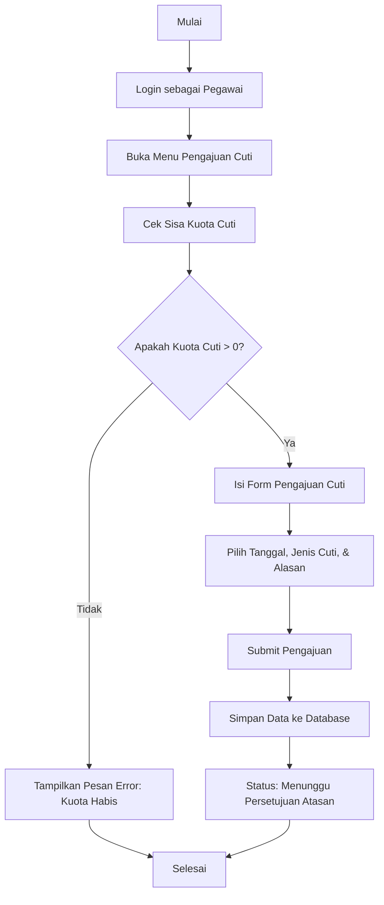
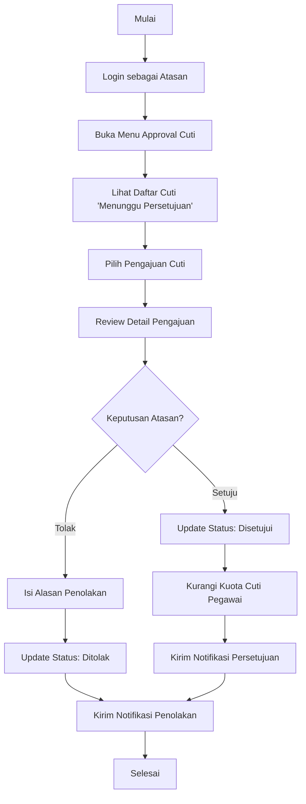
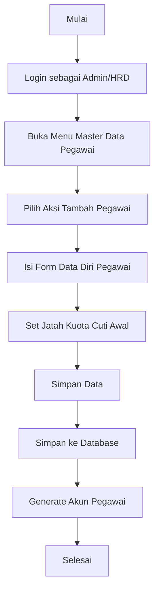

# Alur Flow Chart - Aplikasi E-Cuti

Dokumen ini berisi representasi Flow Chart dari berbagai proses utama dalam Aplikasi E-Cuti menggunakan notasi Mermaid. Anda dapat melihat visualisasinya di markdown viewer yang mendukung Mermaid.

## 1. Flow Chart Pengajuan Cuti (Pegawai)

Flow chart ini menggambarkan alur saat pegawai mengajukan cuti hingga statusnya berubah menjadi menunggu persetujuan.

## 2. Flow Chart Persetujuan Cuti (Atasan)

Flow chart ini menggambarkan proses saat atasan meninjau dan memberikan keputusan terhadap pengajuan cuti pegawai.

## 3. Flow Chart Kelola Data Pegawai (Admin/HRD)

Flow chart ini menggambarkan alur admin dalam menambah atau mengelola data pegawai baru.

---
*Catatan: Anda dapat menggunakan ekstensi Markdown Preview di VS Code (atau platform lain) yang mendukung Mermaid untuk melihat grafik secara visual.*
